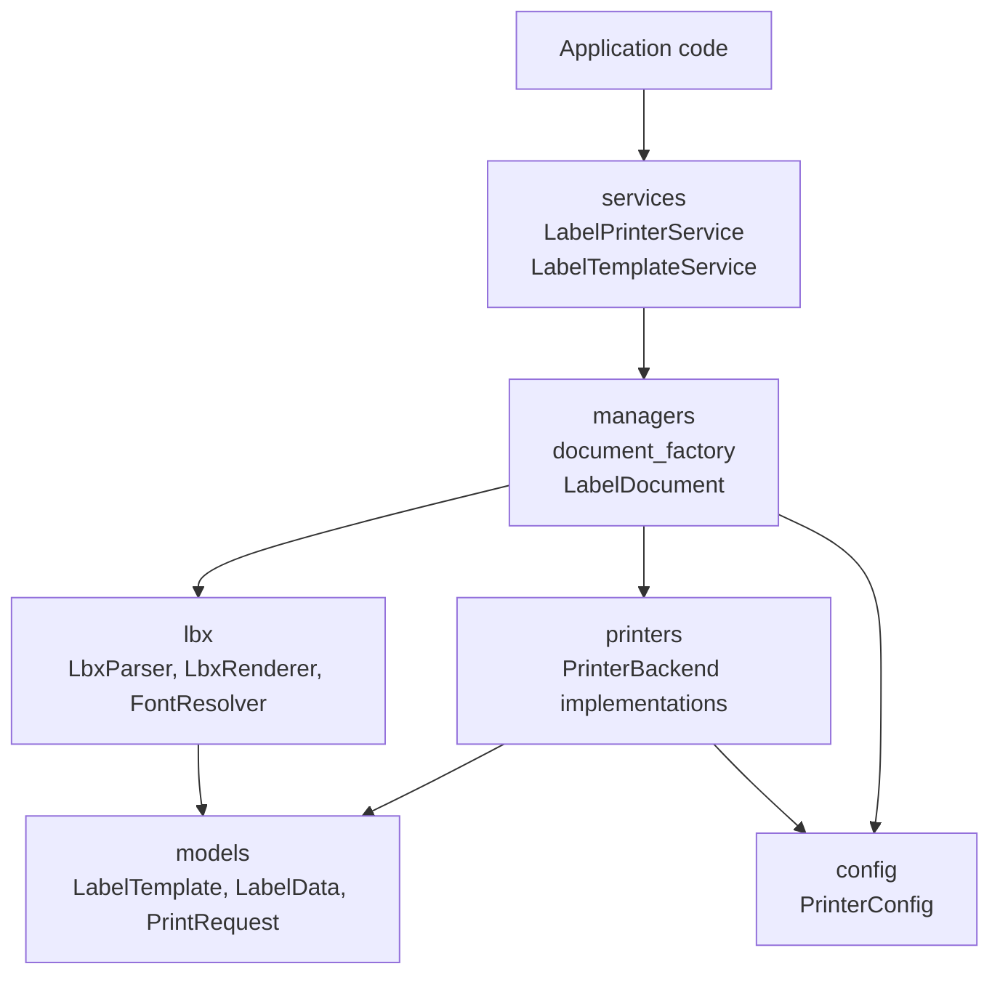
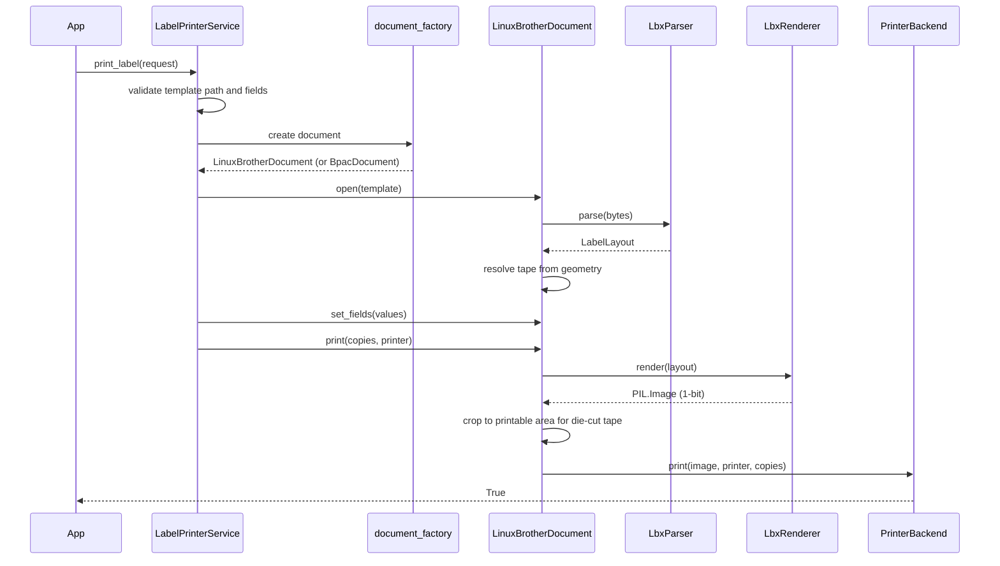

# Architecture

## Goals

`lbx-printer` is a standalone library. It must not depend on an application
framework, a database, a web server or a global configuration object. Three
constraints shaped the design:

1. **One template, two very different printers.** On Windows the Brother b-PAC
   SDK does the parsing, layout and rendering internally. On Linux and macOS
   nothing of that exists, so the package must parse and render the template
   itself and stream raster data.
2. **Rendering must be testable without hardware.** Everything up to the final
   transport step runs in memory and can be exercised in unit tests.
3. **The public surface must stay small.** Internal modules may move; the
   package root is the contract.

## Layers



| Layer | Responsibility | Depends on |
| --- | --- | --- |
| `models` | Value objects passed between layers | exceptions only |
| `lbx` | `.lbx` parsing, layout model, rendering, fonts | models, exceptions |
| `printers` | Transport backends and tape resolution | models, exceptions |
| `managers` | Platform documents and the factory | lbx, printers, config |
| `services` | Application-facing helpers | managers, models |
| `config` | Immutable settings objects | exceptions |
| `i18n`, `logging` | Cross-cutting utilities | stdlib |

The dependency direction is strictly downwards. `lbx` and `printers` never import
`managers`, so they can be used on their own, for example to render previews.

## Printing pipeline



On Windows the same service and the same request objects are used, but
`BpacDocument` forwards `open`, `set_field` and `print` to the b-PAC COM object
instead of rendering locally.

## Dependency injection and inversion of control

Every collaborator is passed in; nothing is constructed from a global singleton:

| Component | Injected into | Default |
| --- | --- | --- |
| `LabelDocument` factory | `LabelPrinterService` | `managers.document_factory` |
| `LbxRenderer` | `LinuxBrotherDocument` | `LbxRenderer(dpi=config.dpi)` |
| `LbxParser` | `LinuxBrotherDocument`, `LabelTemplateService` | `LbxParser()` |
| `BrotherQlLabelResolver` | `LinuxBrotherDocument` | `BrotherQlLabelResolver()` |
| `TapeSpec` provider | `LinuxBrotherDocument` | `default_tape_spec` (brother_ql) |
| `PrinterBackend` | `LinuxBrotherDocument` | `BrotherQlRasterBackend(host, model, label)` |
| `FontResolver` | `LbxRenderer` | `FontResolver()` |
| `PrinterConfig` | `document_factory` | `PrinterConfig.from_env()` |

The factory is the only composition root. It is the single place that knows
which platform is active, and the only place that imports the platform document
classes, which keeps COM and raster dependencies out of the other modules.

## Resource ownership

- **Parsed templates** are plain Python objects owned by the caller. The
  document keeps one layout per open document and releases it in `_initialize`
  and `close`.
- **Images** are created by the renderer and owned by the backend call. No
  temporary files are written anywhere; `FileBackend` writes files only because
  that is its documented purpose.
- **COM resources** (b-PAC) are acquired in `_initialize` and released in
  `close`. `close()` is always called by the context manager, even when the body
  raises, and never raises itself.
- **Fonts** are cached per `(family, bold, italic, size)`; the cache is bounded
  by the number of distinct styles in the templates being rendered.

## Error model

```text
PrinterError
├── ConfigurationError
├── MissingDependencyError
├── LabelTemplateNotFoundError
├── LabelAlreadyExistsError
├── LabelFieldNotFoundError
├── LabelDataMissingError
├── PrinterStateError
├── BpacConnectionError
└── UnsupportedLabelError (also a ValueError)
```

Rules:

- Validation happens before any resource is touched (`PrintRequest` copies must
  be positive, `PrinterConfig` values must be in range, templates must exist).
- Optional dependencies raise `MissingDependencyError` with an installation hint
  at the point of use, never at import time.
- Backend errors propagate unchanged; the package does not swallow transport or
  ``brother_ql`` failures.
- Messages are localised via `lbx_printer.i18n`; details stay in attributes.

## Thread safety

| Component | Shared between threads |
| --- | --- |
| `LbxParser` | yes (stateless) |
| `LbxRenderer` | yes (no state between renders) |
| `FontResolver` | yes (double-checked cache under a lock) |
| `BrotherQlLabelResolver` | yes (immutable catalogue) |
| Backends | yes (per-job state only) |
| `LabelDocument` | no - one document per thread and job |
| `BpacDocument` | no - COM apartment-bound |

## Extension points

1. `PrinterBackend` - new transports (USB, IPP, spooler, cloud).
2. `LabelDocument` - new template engines or operating systems.
3. `FontResolver` substitutions and extra font directories - typography.
4. `tape_spec_provider` - tape catalogue for printers not covered by
   `brother_ql`.
5. `i18n` catalogues - additional locales.

## Deliberate limitations

- Barcode and image objects are parsed and positioned but not rendered. Templates
  that rely on them should be printed through b-PAC on Windows.
- Text runs keep their per-run family, weight and slant; the font size is taken
  from the object as P-touch Editor already resolved the shrink result.
- The raster backend addresses one printer per document (`host`, `port`);
  queue names are meaningful for the CUPS backend only.
